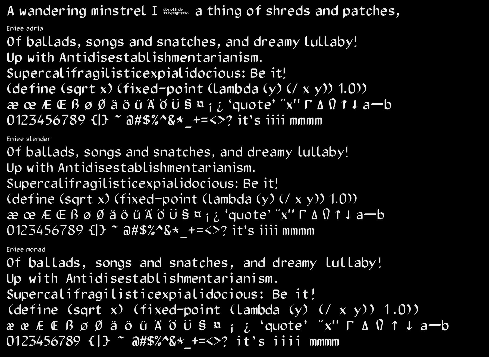
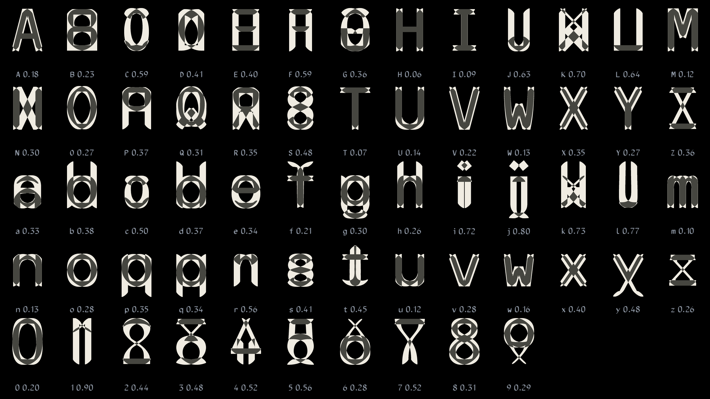
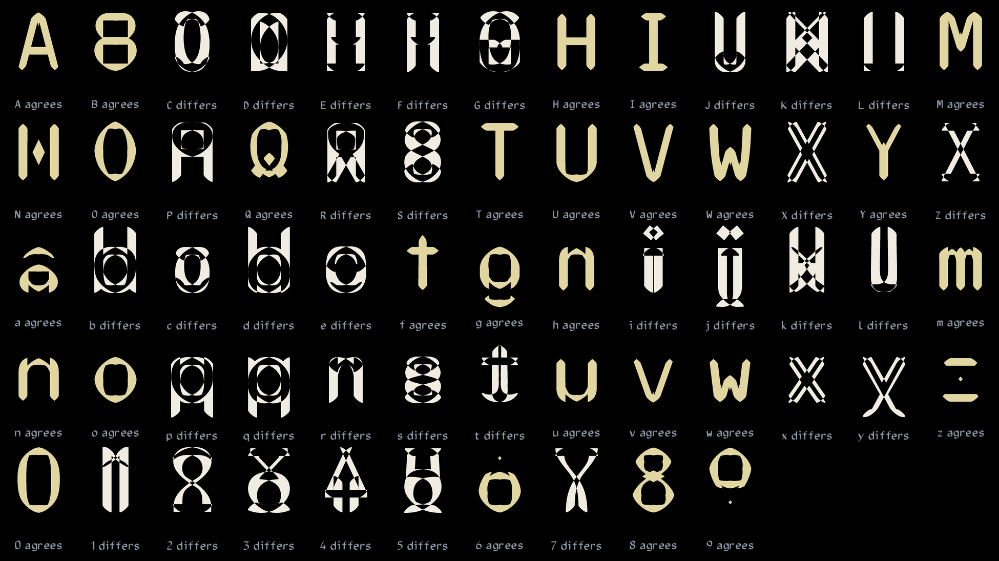
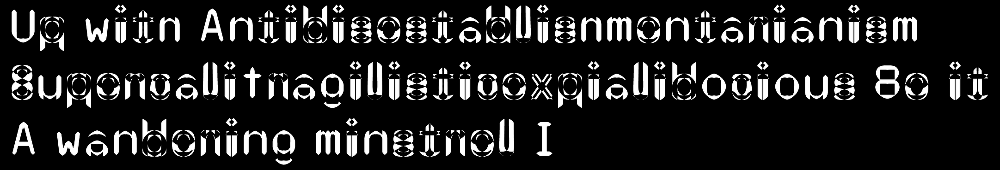

# Eniee

OCR-B, drawn again with a flat nib held at forty degrees.

**[See it set, in your browser →](https://silberpunkt.github.io/eniee/)**

Norbert Schwarz put Adrian Frutiger's OCR-B into METAFONT in the 1980s. In his version every stroke is a path traced by a round pen. Eniee keeps those paths and changes the pen to a broad, flat nib, 1.35 by 0.34 of OCR-B's stroke, turned 40°. Uprights and bars come out nearly equal in weight. The contrast moves into the diagonals and around the bowls. A few characters were then redrawn by hand:

- the dots are squares, and the i, j and colon dots are turned to the nib's angle;
- the comma is a square dot with a short tail;
- k's leg and 1's flag are curved and drawn with a narrower nib;
- the quotes are a turned pair;
- æ, œ, Æ and Œ are drawn as pairs that share their strokes where the letters meet.



| font | | |
|---|---|---|
| **Eniee Adria** | proportional | each letter its own ink plus 0.55 stroke a side |
| **Eniee Slender** | proportional, lighter | nib and dots at 86% |
| **Eniee Monad** | monospaced | one cell for every character, weight between the two |

`fonts/` holds each font as OpenType (`.otf`), WOFF and WOFF2. `index.html` is a specimen page that uses the WOFF2s.

## Two dashes

Eniee has no en dash. In its place is a message, set in the font's own letters: *do not hide / in typography.* It answers only to the en dash itself, U+2013. The em dash, U+2014, is the hyphen made twice over. Two or three hyphens typed in a row stay hyphens, exactly as typed: the fonts have no ligatures, so nothing you write is changed behind your back. (In TeX, where `--` and `---` have always meant the dashes, the METAFONT source keeps them.)

## On the web

```css
@font-face { font-family: "Eniee Adria"; src: url(EnieeAdria-Regular.woff2) format("woff2"), url(EnieeAdria-Regular.woff) format("woff"); }
body { font-family: "Eniee Adria", monospace; }
```

## Character set

- ASCII.
- ‘ ’ “ ” ¡ ¿ ß æ œ ø Æ Œ Ø ä ö ü Ä Ö Ü § ¤ ¦ ı ȷ.
- Γ Δ Ξ Π Σ Υ Φ Ψ Ω ↑ ↓.
- The spacing accents ´ ˋ ˇ ˘ ¯ ˚ ¸ ¨ and a prime ′.

That is OCR-B's own repertoire, 138 characters. There are no other accented letters yet: no é, å or ñ. METAFONT built each umlaut as a whole character. Making é and the rest means composing them from the letters and accents above, and that is still to do.

**Eniee Monad also has** (from version 1.200) the characters a text-mode drawing needs, so that nothing is borrowed from another font with another width:

- box drawing, U+2500 to U+257F: light, heavy, double, dashed, arcs and diagonals, all 128;
- block elements and shades, U+2580 to U+259F;
- Braille, U+2800 to U+28FF, with Eniee's square dots, including the blank cell U+2800;
- combining marks, zero width, over or under the cell before them: the common accents above (U+0300 to U+030C) and the marks below that YOWL colorbursts use (U+0316 to U+0332);
- a no-break space;
- (1.300) accented Latin, about 330 letters (é, å, ñ, ş, ǖ, ạ and the rest), each built from Eniee's own letter and its own mark, the mark centred over the cell and lifted over capitals and ascenders. The marks keep about six tenths of the nib's weight or more. The grave is the acute turned left for right: OCR-B's own short grave reads as a dot at text sizes;
- (1.300) a safety net: every other character DejaVu Sans Mono has, about 2,650 of them (Greek, Cyrillic, mathematics, arrows, symbols such as ◎ ★ ☾ ✣ ʃ), scaled to Monad's cell. Those glyphs are DejaVu's own drawing, not Eniee's, and keep the Bitstream Vera licence (LICENSE-DejaVu.txt). The plan is to replace them with Eniee's own drawings in time.

`tools/extras.py` makes all of these by program, reading most of what to draw from the Unicode character names. Boxes and blocks fill the whole line box, gap included, so they join from line to line. To make that work on Windows too, Monad's Windows line metrics equal that box, and three tall accents (ˇ ˘ ¸) may lose a hair at the top or bottom in programs that clip to it.

## How it is made

The outlines are traced from METAFONT's own output. They are not hand-drawn béziers.

1. `source/` is the METAFONT: `eniee-adria.mf` holds the nib and the redrawn characters. `eniee-slender.mf` and `eniee-monad.mf` set the weight and the cell, then load it. Schwarz's `ocrbmac.mf` and `ocrbdef.mf` are unchanged.
2. METAFONT cuts each font at 4800 dpi, which puts 664 pixels in a 10 pt em.
3. `tools/gf2glyphs.js` (QuickJS) reads METAFONT's GF file: each character's bitmap, its box and its width.
4. `tools/trace.py` traces each bitmap with potrace into curves at 1000 units to the em.
5. `tools/build.py` (fontTools) builds the CFF OpenType font with the dash ligatures, then the WOFF and WOFF2.

Character widths, the word space and the ligatures come straight from METAFONT (the TFM). Only the shapes pass through tracing. `tools/build.sh` runs all of it; `tools/specimen.py` draws specimen.png.

For TeX, use the METAFONT directly:

```
mf '\mode=ljfour; input eniee-adria'
```

then `\font\ea=eniee-adria` in plain TeX.

## Honest-forms

This experiment is User1's. Take a letter and XOR it with itself flipped left for right. What is left is the letter's handedness: the part a mirror would undo. The result is always symmetric left to right, the way sound is.



The number under each letter is the share of its ink that differs from its mirror. A 40° nib is never its own mirror, so no letter scores zero. Even H keeps a sliver of white at its terminals.

- Nearly their own mirror: H 0.06, T 0.07, I 0.09, m 0.10.
- Most handed: 1 0.90, j 0.80, l 0.77.

A letter and its mirror together cover one area, and XOR splits it in two:

- where they differ, the letter's handedness;
- where they agree, its core.

As with reversed wood type, you keep the fuller half:

- **Letters that keep their core:** H I O T U, m n, and others like them. They come out as themselves, trimmed square.
- **Letters that keep their difference:** the one-sided and round-sided letters, C D E, b d, i j l, 1 2 3. They come out as folded-paper patterns.





`honest/honest.py` and `honest/honest2.py` make these images from the bitmaps that `tools/gf2glyphs.js` writes.

## Licence

Schwarz's terms are: "You may freely use, modify, and/or distribute this file, without limitation."
Eniee is given on the same terms. See `LICENSE.txt`.

OCR-B is Adrian Frutiger's design (1968). It is standardized as ISO 1073-2.

Made by User1 (silberpunkt), with eniamb, November 2026.
